# Workflow States (MissionWorkflow)

Owner: Hariom Verma (Temporal core). Matches `MissionWorkflowImpl.java` on branch `feature/hariom-workflow-devops`.

Status labels used in this doc:
- **Tested**: a passing automated test exists (`MissionWorkflowTest`).
- **Implemented, test pending**: code exists, no test yet.
- **Proposed**: not in code yet / needs mentor confirmation.

## State diagram

```mermaid
stateDiagram-v2
    [*] --> CREATED: REST API creates mission (Naveen)
    CREATED --> SCHEDULED: Workflow starts
    SCHEDULED --> IN_PROGRESS: dispatch done
    IN_PROGRESS --> IN_PROGRESS: flyToWaypoint (per waypoint)
    IN_PROGRESS --> RETURNING: all waypoints done
    RETURNING --> COMPLETED: returnToBase ok
    IN_PROGRESS --> RETURNING: abortMission signal
    RETURNING --> ABORTED: returnToBase ok (abort path)
    IN_PROGRESS --> SUSPENDED_OFFLINE: droneOffline signal
    SUSPENDED_OFFLINE --> RECOVERING: droneReconnected within 5 min
    RECOVERING --> IN_PROGRESS: resume route
    SUSPENDED_OFFLINE --> RETURNING: abort, or 5 min timeout
    RETURNING --> FAILED: timeout path (message tells if return worked)
    COMPLETED --> [*]
    ABORTED --> [*]
    FAILED --> [*]
```

## States

| State | Meaning | Set by | Status |
|---|---|---|---|
| CREATED | Mission saved, workflow not started | API (not Workflow) | Proposed (API side) |
| SCHEDULED | Workflow started, drone being dispatched | Workflow | Tested |
| IN_PROGRESS | Flying waypoints | Workflow | Tested |
| SUSPENDED_OFFLINE | Drone offline, Workflow waiting durably (max 5 min) | Workflow | Tested (entered and still waiting at 4 min) |
| RECOVERING | Reconnected, validating before resume | Workflow | Implemented, test pending |
| RETURNING | Going back to base (normal end, abort, or timeout) | Workflow | Tested (normal + abort) |
| COMPLETED | Delivered and back at base | Workflow | Tested |
| ABORTED | Operator abort, drone back at base | Workflow | Tested |
| FAILED | Offline timeout (or return-to-base failure in that path) | Workflow | Tested for timeout + successful return; the "return also failed" branch is not tested |

## Flows

**Happy path (Tested):** SCHEDULED -> IN_PROGRESS -> (flyToWaypoint x N) -> RETURNING -> COMPLETED.

**Abort (Tested):** `abortMission` Signal sets a flag. The flag is checked between waypoints. Then RETURNING -> returnToBase -> ABORTED. Reason for returning to base: a drone left mid-air is a safety/asset risk.

**Offline / reconnect (Implemented, reconnect test pending):** `droneOffline` -> SUSPENDED_OFFLINE -> `Workflow.await(5 min, reconnected || aborted)` -> reconnect gives RECOVERING -> IN_PROGRESS and the route resumes.

**Offline timeout (Tested):** no reconnect in 5 min -> RETURNING -> returnToBase. If it succeeds: FAILED with message "Drone safely returned to base; delivery was not completed." If the Activity fails: FAILED with "return to base also failed."

## Signals, Query, Activities

| Name | Type | Purpose |
|---|---|---|
| `abortMission()` | Signal | Request abort |
| `droneOffline()` | Signal | Drone lost link |
| `droneReconnected()` | Signal | Link back (ignored unless currently offline, so duplicates are safe) |
| `getMissionState()` | Query | Read current state (read-only, not in history) |
| `dispatch` | Activity | Send drone |
| `flyToWaypoint(missionId, droneId, index, lat, lon)` | Activity | Fly one leg |
| `returnToBase` | Activity | Return home |
| `updateBusinessStatus(missionId, status, message)` | Activity | Write status to MySQL (side effect, so Activity) |

Activity options: StartToClose 30 s; retry initial 1 s, max 3 attempts.

`setState` sets the in-memory `state` first (so the Query answers right away), then calls the `updateBusinessStatus` Activity (the DB write).

## Known gaps (honest list)

1. No `reroute` Signal yet (API_CONTRACT lists it). Proposed.
2. If `flyToWaypoint` fails after 3 retries, the exception is not mapped to a business FAILED state. Proposed.
3. Offline and abort are noticed only between waypoints, not mid-Activity.
4. Activity bodies are TODO stubs (Trishul: simulator + DB).
5. 5-minute offline timeout is not confirmed by mentor (`TODO` in code).
6. Abort audit event is not implemented.
7. Reconnect (RECOVERING), offline-then-abort, duplicate signals and the worker-restart test are still pending. The offline-timeout path is tested (see WORKFLOW_TESTS.md).
