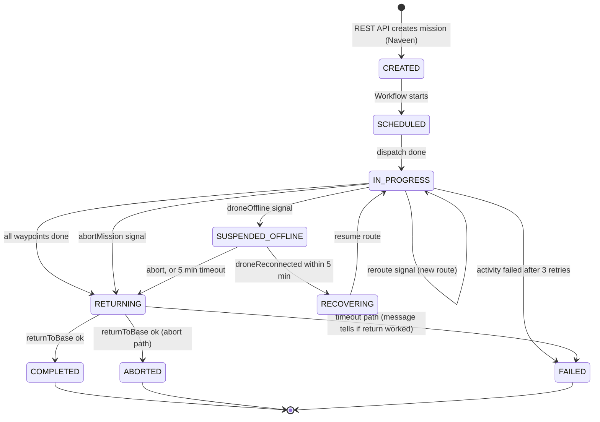

# Workflow States (MissionWorkflow)

Owner: Hariom Verma (Temporal core). Matches `MissionWorkflowImpl.java` on `main` (includes Naveen's reroute, activity-failure and event-key changes from PR #5).

Status labels used in this doc:
- **Tested**: a passing automated test exists (`MissionWorkflowTest`).
- **Implemented, test pending**: code exists, no test yet.
- **Proposed**: not in code yet / needs mentor confirmation.

## State diagram

## States

| State | Meaning | Set by | Status |
|---|---|---|---|
| CREATED | Mission saved, workflow not started | API (not Workflow) | Proposed (API side) |
| SCHEDULED | Workflow started, drone being dispatched | Workflow | Tested |
| IN_PROGRESS | Flying waypoints | Workflow | Tested |
| SUSPENDED_OFFLINE | Drone offline, Workflow waiting durably (max 5 min) | Workflow | Tested (entered and still waiting at 4 min) |
| RECOVERING | Reconnected, validating before resume | Workflow | Implemented, test pending |
| RETURNING | Going back to base (normal end, abort, or timeout) | Workflow | Tested (normal + abort) |
| COMPLETED | Delivered and back at base | Workflow | Tested |
| ABORTED | Operator abort, drone back at base | Workflow | Tested |
| FAILED | Offline timeout (or return-to-base failure in that path), or an Activity failing after all retries | Workflow | Tested for timeout + successful return and for Activity failure; the "return also failed" branch is not tested |

## Flows

**Happy path (Tested):** SCHEDULED -> IN_PROGRESS -> (flyToWaypoint x N) -> RETURNING -> COMPLETED.

**Abort (Tested):** `abortMission` Signal sets a flag. The flag is checked between waypoints. Then RETURNING -> returnToBase -> ABORTED. Reason for returning to base: a drone left mid-air is a safety/asset risk.

**Offline / reconnect (Implemented, reconnect test pending):** `droneOffline` -> SUSPENDED_OFFLINE -> `Workflow.await(5 min, reconnected || aborted)` -> reconnect gives RECOVERING -> IN_PROGRESS and the route resumes.

**Reroute (Tested):** `reroute(waypoints)` Signal replaces the route while the mission is IN_PROGRESS. The Workflow validates it (1 to 100 waypoints, latitude -90 to 90, longitude -180 to 180), increases `routeRevision`, and the running waypoint wait wakes up. The new route is flown from its first waypoint. Rejected (exception) if the mission is not IN_PROGRESS, is offline, or is aborted.

**Activity failure (Tested):** if an Activity still fails after 3 attempts, the Workflow writes FAILED ("Mission execution failed after activity retries") and then fails itself, so Temporal UI also shows the execution as failed.

**Cancellation (Tested):** if the Workflow is cancelled, FAILED is not written (cancel is an operator decision, not a failure). There is no CANCELLED state yet.

**Offline timeout (Tested):** no reconnect in 5 min -> RETURNING -> returnToBase. If it succeeds: FAILED with message "Drone safely returned to base; delivery was not completed." If the Activity fails: FAILED with "return to base also failed."

## Signals, Query, Activities

| Name | Type | Purpose |
|---|---|---|
| `abortMission()` | Signal | Request abort |
| `droneOffline()` | Signal | Drone lost link |
| `droneReconnected()` | Signal | Link back (ignored unless currently offline, so duplicates are safe) |
| `reroute(List<WaypointRequest>)` | Signal | Replace the route during flight (validated) |
| `getMissionState()` | Query | Read current state (read-only, not in history) |
| `dispatch` | Activity | Send drone |
| `flyToWaypoint(missionId, droneId, index, lat, lon)` | Activity | Fly one leg |
| `returnToBase` | Activity | Return home |
| `updateBusinessStatus(missionId, status, message, eventKey)` | Activity | Write status to MySQL (side effect, so Activity). `eventKey` = `status:<transition number>:<STATE>`, so a retried write is not duplicated |

Activity options: StartToClose 30 s; retry initial 1 s, max 3 attempts.

`setState` sets the in-memory `state` first (so the Query answers right away), then calls the `updateBusinessStatus` Activity (the DB write) with the next `eventKey`.

## Known gaps (honest list)

1. Offline and abort are noticed only between waypoints, not mid-Activity.
2. The Workflow tests use mocked Activities, so the Activity bodies (simulator, DB writes) are not covered by these tests.
3. The 5-minute offline timeout is not confirmed by the mentor (`Confirm with mentor` comment in code). Note: Naveen's earlier branch used 10 minutes.
4. Reroute restarts from the first waypoint of the new route. This is correct only if the new route starts from the drone's current position. To be confirmed.
5. `reroute` throws an exception in a Signal handler when the state is wrong. The API layer should check the state first. Not tested at Workflow level (invalid input and wrong state).
6. There is no CANCELLED state, so a cancelled mission can stay IN_PROGRESS in the database.
7. Abort audit event is not implemented.
8. Reconnect (RECOVERING), offline-then-abort, duplicate Signals, Activity timeouts and the worker-restart test are still pending (see WORKFLOW_TESTS.md).
